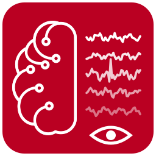
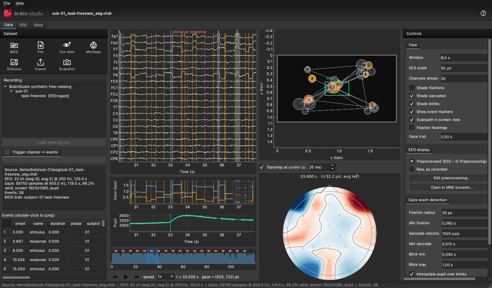
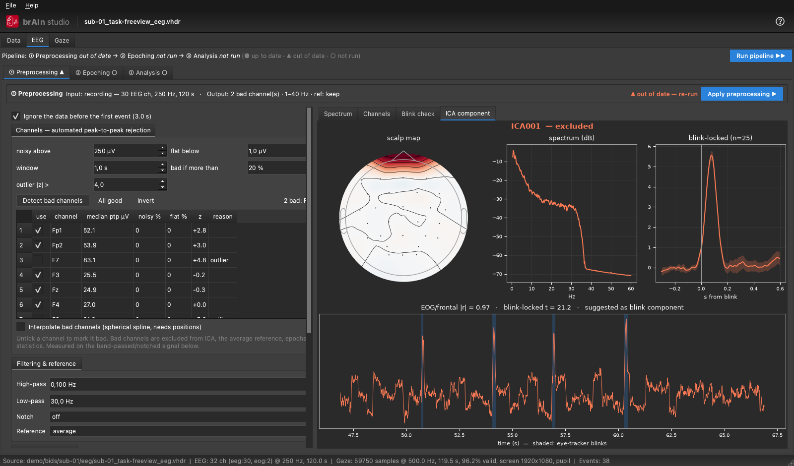
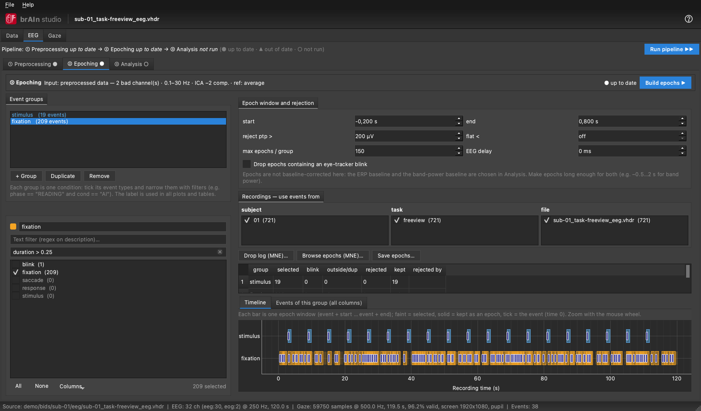
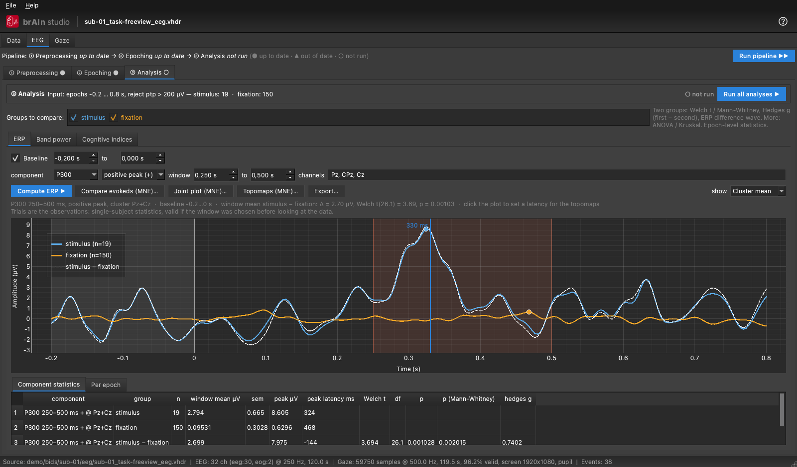
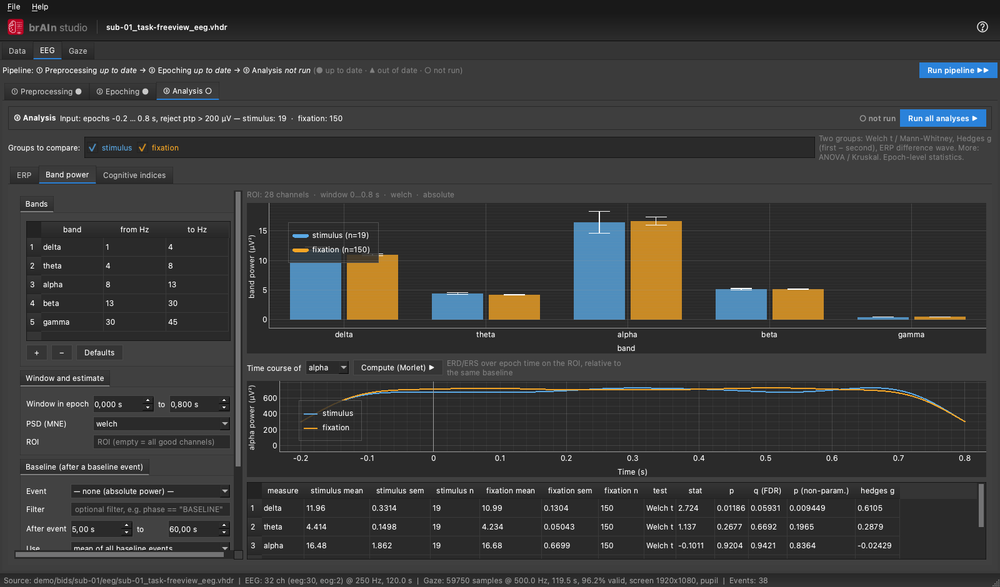

# brAInStudio



brAInStudio is a desktop app and Python library for analysing **simultaneous EEG and
eye-tracking recordings**. It loads XDF (Lab Streaming Layer), EDF/BDF and other EEG
files, and BIDS datasets. It shows EEG and gaze on one time base, and takes the EEG
through a **preprocessing → epoching → analysis** pipeline: ERP components, band power
and cognitive-state indices, compared between groups of events.

- [MNE-Python](https://mne.tools) and [MNE-BIDS](https://mne.tools/mne-bids) do the EEG
  work: reading, filtering, ICA, epochs, evokeds, spectra and statistics.
- [PyGaze](https://www.pygaze.org) provides the areas of interest (AOIs). brAInStudio
  reimplements the PyGazeAnalyser event detectors.
- The interface is PySide6 and pyqtgraph, in the dark style of the ITU brAIn lab's
  other apps.



## Contents

- [Install and run](#install-and-run)
- [Loading data](#loading-data)
- [The Data tab](#the-data-tab)
- [The EEG pipeline](#the-eeg-pipeline)
- [The Gaze tab](#the-gaze-tab)
- [Events, groups and filters](#events-groups-and-filters)
- [Montages and channel layouts](#montages-and-channel-layouts)
- [Using the library](#using-the-library)
- [Project layout](#project-layout)
- [Development](#development)
- [Notes and limitations](#notes-and-limitations)
- [Acknowledgements](#acknowledgements)

## Install and run

**Packages**: every [release](https://github.com/itubrainlab/brainstudio/releases) has a
standalone app for macOS (`.dmg`), Windows (`.zip`, run `brAInStudio.exe`) and Linux
(`.tar.gz`, run `brAInStudio/brAInStudio`), plus a wheel. The apps are not signed:
- macOS: the first time, right-click the app and choose **Open**.
- Windows: SmartScreen may ask you to confirm.

**From source**: you need Python 3.12 or newer and [uv](https://docs.astral.sh/uv/). It
runs on macOS, Linux and Windows.

```bash
uv sync
```

Open the app with a synthetic EEG and eye-tracking dataset (BIDS and XDF, written to a
temporary folder):

```bash
uv run brainstudio --demo
```

Open your own data: a BIDS dataset folder, or a file.

```bash
uv run brainstudio /path/to/bids_root
```

```bash
uv run brainstudio /path/to/recording.xdf --screen 1920x1080
```

`--screen` sets the stimulus screen size in pixels, used for normalised gaze
coordinates. `uv run brainstudio-demo OUTDIR` writes the demo dataset to a folder.

## Loading data

| Input | EEG | Gaze | Events |
|---|---|---|---|
| **XDF** (LSL) | stream of type EEG/ExG, else the largest numeric stream | stream scored on type, name and channel labels (gaze, eye, pupil, POG…) | marker streams: single or multi-column, see below |
| **EDF/BDF, BrainVision, EEGLAB, FIF** | any MNE-readable file | MNE eye-tracking channels | annotations; a trigger channel (see below) |
| **BIDS dataset** (folder) | `*_eeg.{vhdr,edf,bdf,set,fif}` via `mne_bids.read_raw_bids` | BIDS eye tracking (`*_recording-<eye>_physio.tsv.gz` + JSON), legacy `*_eyetrack.tsv`, MNE eye-tracking channels | `events.tsv`, `*_physioevents.tsv.gz` messages |
| **EyeLink `.asc`** | – | `mne.io.read_raw_eyelink` | messages |

Use the ribbon at the top of the Dataset panel, or the **File** menu:

- **BIDS** opens a dataset folder. Its runs are listed in a tree.
- **File** opens one file, or **several at once** (see *Several files* below).
- **Eye data** attaches a separate eye-tracking file to the loaded recording.

### XDF streams and their roles

The **Streams** table lists every stream with its channel count, sampling rate, and the
role it plays: **EEG**, **gaze**, **markers** or **ignore**.

- Roles are chosen automatically.
- To change them, pick a role and press **Reload**. **Automatic** restores the automatic
  roles.
- At most one stream can be EEG and one gaze.

Some LSL apps send numeric samples as text (Gazepoint, for example). Text streams with a
regular rate and numeric values are read as numbers.

**Details…** (or a double-click) opens the stream dialog. It shows:

- **stream information**: format, channels, nominal and effective rate, samples,
  duration, first timestamp, source id, host, manufacturer and clock notes;
- **per-channel settings**, with a preview of each channel's values:
  - **EEG**: include or exclude channels, rename them, set their type
    (eeg/eog/ecg/emg/misc/stim);
  - **gaze**: which channels are x, y, pupil and validity. Several channels are averaged,
    for example the left and right eye. Gazepoint `BPOGX/BPOGY`, `BPOGV` and
    `LPD/RPD` are found automatically.
  - **markers**: the role of each column (*name*, *start/stop flag*, *attribute*,
    *ignore*) and its name.

### Multi-column marker streams

Marker streams often carry several text columns per sample, for example
`['start', 'trials', 'clip.mp4', 'sad', …]`. brAInStudio loads **every column**:

- **Start/stop flag**: a `start` row and the next `stop`/`end` row with the same name
  become one event with a duration. The stop row fills in values the start row left
  empty, such as a response. An instant `<name>_end` event can be added as well.
- **Name** columns form the event name.
- **Attribute** columns become filterable event columns. Unlabelled columns are named
  `<stream>_<k>`, so two streams never collide; rename them in the stream dialog.
- Events with a duration also act as **phases**: gaze fixations inside a trial inherit
  the trial's name and attributes.

### BIDS dataset information

Loading a BIDS run also reads the dataset's own information:

- **Bad channels** from `channels.tsv` (`status` = bad, with `status_description`). They
  start unticked in ① Preprocessing, labelled *bad in the dataset* with the reason.
  **Detect bad channels** adds to them; you can re-tick any channel.
- **Events with every column** of `events.tsv`. `trial_type` is the event name, and
  every other column (e.g. `SOA`, `label`, `answering_time`) becomes a filterable column,
  named in lower case (`soa`). MNE-BIDS alone keeps only `trial_type`. Data annotations
  such as `BAD_ACQ_SKIP` are kept.
- **Electrode positions** from the dataset's `electrodes.tsv` and `coordsystem.json`,
  including subject-level files such as `sub-01_space-CapTrak_electrodes.tsv`. Without
  one, the 10-05 template is matched by channel name.
- **Channel types** from `channels.tsv`, and the **power-line frequency**
  (`PowerLineFrequency`), which sets the notch filter.
- The **info panel** shows the dataset (name, authors, licence, DOI), the participant
  (`participants.tsv`), and the device and cap. It also shows reference, ground and
  placement, the online filters already applied, the recording timing, and where the
  positions came from.

MNE-BIDS reads the files. If it fails on broken sidecars, brAInStudio falls back to a
plain reader and applies `channels.tsv` itself. When runs are combined, a channel bad in
any run is bad in the combined recording.

### Several files

Several XDF files, several EDF/BDF/… files, or several BIDS runs can be loaded together.
In the BIDS tree, select runs, a subject or a session, then use **Load selected runs
together**. The files are joined end to end into one recording:

- EEG is joined with `mne.concatenate_raws` on the channels all files share.
- Sampling rates that differ by less than 0.1 % are aligned (the same amplifier's
  effective rate varies by a few ppm); others are resampled.
- `BAD boundary` annotations keep epochs from spanning two files.
- Gaze and markers are shifted onto the joined time base.

Every event carries the `subject`, `session`, `bids_task`, `acq`, `run` and `file` of its
file:

- They come from the BIDS dataset, or are parsed from BIDS-style file names such as
  `sub-01_ses-2_task-x_run-003_eeg.xdf`.
- They are kept as text, so filter with `run == "003"`.

### Trigger channels (EDF/BDF and others)

The **Trigger channel → events** panel turns the codes on a channel into events. It opens
by itself when a channel looks like a trigger (`TRIG`, BioSemi `Status`, `STI…`).

1. Pick the channel and a mode:
   - *integer codes*: the reader's unit scaling is undone, values are rounded, and
     `mne.find_events` reports every change, with an optional bit mask;
   - *pulses*: for analog channels such as a photodiode. A pulse is a crossing of the
     level half-way between rest and the largest pulse.
2. **Find events** lists the codes and their counts. Tick the codes to use and name
   them; codes with the same name are pooled.
3. **Add as events** puts them into the event table, and can re-type the channel as
   `stim` so it is left out of the EEG.

When a file is loaded, channels that a reader typed as EEG but whose names say otherwise
are re-typed:

- TRIG and Status → stim;
- EOG, ECG and EMG → their own types;
- the accelerometer, gyroscope, battery, counter and validation channels of the g.tec
  Unicorn → misc.

### Time alignment

Everything lives on one time base: t = 0 is the first EEG sample.

- **XDF**:
  - pyxdf applies the LSL clock offsets stored in the file.
  - brAInStudio then removes jitter from each regular stream with one linear fit per
    gap-free segment, and uses the *effective* sampling rate.
  - When a stream's rate is not constant (some Gazepoint recordings drop samples or
    change rate), the straight line can drift seconds away from the timestamps.
    brAInStudio then follows the timestamps' 5 s trend instead and notes this in the
    info panel, so gaze stays aligned with the EEG over the whole recording.
  - Some devices stamp a few samples on another clock (Gazepoint, for example).
    brAInStudio detects and removes these samples, and uses them to estimate the offset
    between the clocks. A stream that does not overlap the EEG is moved onto the EEG
    clock with that offset.
  - If no offset can be found, the stream starts are aligned and the info panel shows a
    **WARNING**.
  - Every step is listed in the info panel.
- **BIDS**: gaze uses the sidecar `StartTime`. Tracker timestamps define the sample times.
- **Gaze offset** (Controls panel) shifts gaze relative to the EEG by hand. Blinks,
  fixations and saccades are re-detected, and a fitted ICA is rescored against the
  shifted blinks: the scores, the component view and the blink check all update. Your
  ticked components stay as they are.

Gaze coordinates are in screen pixels:

- Normalised coordinates (Gazepoint, Tobii, Pupil Labs) are scaled to the screen size.
- Samples are treated as missing when a validity flag (e.g. `FPOGV`) marks them invalid,
  or when x and y are both 0.
- Pupil size is blanked where gaze is lost.

## The Data tab

Three main tabs: **Data**, **EEG** and **Gaze**. The Data tab holds:

- the **Dataset** panel (left);
- the viewer;
- the screen view and topomap;
- the **Controls** panel (right).

The two panels are fixed, resizable parts of the tab.

**Viewer**

- **EEG traces** with event markers and shaded saccades, blinks and fixations.
- **Subjects** of combined files or BIDS runs: a labelled line marks where each
  recording starts (`sub-01 · ses-1 · run-2`), and the overview strip shades each
  subject. The **Subject** row in the Controls panel jumps to a subject's start
  (◀ ▶ step to the previous / next one) and follows the window as you scroll.
- The traces show the **preprocessed** EEG by default, without the channels marked bad
  in ① Preprocessing. Switch to *Raw* in the Controls panel to see every EEG channel,
  with bad ones greyed.
- Only EEG-type channels are drawn.
- **Gaze** x/y and **pupil** traces on the same time axis, an overview bar (gaze
  validity and events) and playback.
- **Screen view**: live gaze point and trail, numbered scanpath, fixation heatmap,
  optional stimulus image, and draggable **AOIs**.
- **Live topomap** of the EEG around the cursor (needs electrode positions).
- Without gaze data, the eye-tracking views, the Gaze tab and the gaze controls are
  hidden.

**Dataset panel**

- The ribbon: BIDS, File, Eye data, Montage, Stimulus, Export, Snapshot.
- The recording tree.
- The Streams table (XDF) and the trigger panel.
- The info panel.
- The list of markers with all their columns. Double-click a marker to jump to it.

**Controls panel**

- View options: window length, EEG scale, number of channels, overlays.
- EEG display: preprocessed or raw; *Open in MNE browser* adds blinks and saccades as
  annotations.
- Gaze-event detection parameters, gaze offset and screen size.

Shortcuts:

- ←/→ previous/next page
- Space play/pause
- +/− EEG scale
- PgUp/PgDn scroll channels
- click a time plot to move the cursor

## The EEG pipeline

The **EEG** tab is a three-stage pipeline:

- Each stage reads the output of the stage before it.
- A banner shows each stage's input, and whether its results are up to date (●), out of
  date (▲) or not run (○).
- Changing a setting marks that stage, and everything after it, out of date.
- **Run pipeline ▶▶** runs everything from the first stage that is out of date.
- Computations run in the background.

### ① Preprocessing



- **Ignore the data before the first event** (on by default): bad-channel detection and
  the ICA fit use the recording from the first marker on. Set-up, calibration and
  impedance checks before it are left out. Filters and ICA are still applied to the
  whole recording. Gaze events, file boundaries and `BAD_` spans don't count as the
  first event.
- **Channels: automated peak-to-peak rejection.**
  - The data are cut into windows, band-passed and notched like the output will be.
  - A channel is bad when more than a set share of its windows are *noisy* (above a
    peak-to-peak threshold) or *flat*, or when it is a robust-z outlier.
  - Untick channels by hand to mark them bad.
  - Bad channels are left out of ICA, the average reference, epochs and statistics, or
    are interpolated with spherical splines.
- **Filtering and reference.**
  - Default: **0.1–30 Hz** band-pass with a **50 Hz** notch. A BIDS dataset's
    `PowerLineFrequency` sets the notch (e.g. 60 Hz).
  - High-pass from **0 Hz (off)** upwards. Below 0.5 Hz it is a zero-phase 4th-order
    Butterworth (IIR); above that, MNE's FIR.
  - Low-pass and notch.
  - The data keep their **recorded reference**. Re-referencing happens in each analysis:
    ERPs use the reference conventional for the component, band power the average
    reference.
- **ICA blink removal** (`mne.preprocessing.ICA`), following the
  [ERP guide](https://neuraldatascience.io/eeg/erp-artifacts):
  - fitted on a separate **1–30 Hz**, average-referenced copy of the good, non-flat
    channels, whatever the ERP filter;
  - the copy is cut into **1 s segments**; **AutoReject** (`n_interpolate=[1, 2, 4]`,
    `random_state=42`) marks the bad ones, which are left out of the fit. Without
    electrode positions a peak-to-peak threshold is used instead;
  - **99 % of the variance** (or a set number of components), `random_state=42`, every
    3rd sample (more on long recordings: at most 300,000 samples), at most 500
    iterations; picard and infomax run as extended infomax.
- **Labelling the components**:
  - **ICLabel** ([MNE-ICALabel](https://mne.tools/mne-icalabel)): brain, eye blink,
    muscle, heart beat, line noise, channel noise or other, with its probability. It
    gets a 1–100 Hz average-referenced copy, as the network was trained on, and needs
    electrode positions;
  - **EOG**: `find_bads_eog` against the EOG channels or, without them, **Fp1, Fp2, F7,
    F8**. As in the guide, the z threshold starts at 3.5 and steps down by 0.05 until
    two components are found (not below 2.0);
  - **eye tracker**: how strongly a component responds around the tracker's blinks (a
    blink-locked t-score).
  - Suggested (pre-ticked): the EOG picks, ICLabel *eye blink* ≥ 70 %, and blink-locked
    outliers. Check them: automated picks are not always right.
  - Clicking a component shows its scalp map, spectrum, blink-locked average and time
    course. Double-click opens MNE's properties window.
- **Checks**: the spectrum before and after, noisy and flat windows per channel, and the
  blink-locked frontal EEG before and after.

### ② Epoching



- **Event groups** are the conditions. Each group has its own checklist and filters (see
  [Events, groups and filters](#events-groups-and-filters)), and a table of its events
  with every column.
- **Epoch window**:
  - start and end around each event, of any length (up to an hour either side). Before
    building, the memory the epochs need is estimated; above 2 GB you are asked first;
  - defaults from the ERP guide: **−0.1 … 1.0 s**, no fixed amplitude threshold;
  - **AutoReject** (on by default): it interpolates bad channels within an epoch and
    drops the epochs it cannot repair. It is fitted once on the epochs of every group
    (at most 600) and needs electrode positions;
  - optional peak-to-peak and flat rejection;
  - an option to drop epochs that contain an eye-tracker blink;
  - a cap on epochs per group;
  - **EEG delay** (±500 ms) to correct a recording lag between events and EEG.
- **Recordings**: tick the subjects, sessions, runs, tasks or files to use events from.
- **Summary** per group. These add up to *selected*:
  - **blink**: the window contains an eye-tracker blink (when that option is on);
  - **outside recording**: the window (event + start … event + end) does not fit in the
    recording;
  - **same sample**: another selected event of the group is on the same EEG sample (MNE
    needs one per sample);
  - **over cap**: left out by the *max epochs / group* limit (random, reproducible);
  - **rejected (amplitude)**: peak-to-peak or flat rejection; **rejected by** names the
    channels;
  - **rejected (BAD annotation)**: the epoch overlaps a `BAD_…` span or a file boundary;
  - **rejected (AutoReject)**: epochs AutoReject could not repair; **interpolated
    (AutoReject)** counts the channels it interpolated in the epochs kept;
  - **kept**: the epochs used.
- **Timeline**: every epoch as a bar over its window (event + start … event + end), one
  row per group, with a tick at the event. Faint bars are selected events; solid bars
  are kept epochs.
- Epochs are *not* baseline-corrected here: each analysis picks its own baseline.
- Save one `-epo.fif` per group, with the event table as epochs metadata.

### ③ Analysis

**ERP**: component analysis, as in the lab's Rhino ERP.



- **Baseline**: a window before the event; by default from the epoch start to 0 s,
  i.e. MNE's `(None, 0)`.
- **Component presets** set the time window, polarity and channel cluster: P1, N1,
  N170, P2, N2, MMN, P300, N400, LPP. They are conventional starting points; any edit
  makes the component *Custom*.
- **Reference**: choosing a component selects its usual reference — the **average
  reference** for P1 and N170, **mastoids** for N1, P2, N2, MMN, P300, N400 and LPP
  (Custom keeps the current choice). You can change it to *average*, *mastoids*,
  *as recorded* or channel names.
  - Mastoids are the first good pair present: M1/M2, TP9/TP10, A1/A2 (earlobes), or
    P9/P10. Without one, the data stay **as recorded**; the note next to the choice
    says which mastoids are used, or that none were found.
  - The reference is applied to copies of the epochs, before the baseline.
- **Several subjects** (combined files or BIDS runs), as in the
  [group ERP guide](https://neuraldatascience.io/eeg/erp-group-viz):
  - each subject's epochs are averaged on their own: **one Evoked per subject and
    group**;
  - the **grand average** is the average of those Evokeds (`mne.grand_average`), each
    subject weighing the same whatever its number of epochs. Epochs are never pooled
    across subjects;
  - bands are **95 % confidence intervals across subjects**; the *Subjects* view draws
    every subject's ERP under the grand average;
  - difference waves are computed per subject, then averaged, with their own 95 % CI.
  - **Statistics across subjects** (the *Component statistics* table): the subjects'
    window means per group (mean, SEM, 95 % CI) and the grand average's peak. Two
    groups: a **paired t-test** on the subjects that have both — the guide's
    `ttest_1samp` of the difference waves against 0 — with Wilcoxon and Cohen's d_z
    (independent groups of subjects: Welch t-test). More groups: a repeated-measures
    ANOVA and a Friedman test.
  - **Per subject**: each subject's epochs, window mean and peak per group; *Within each
    subject*: the epoch-level test between the groups for every subject, FDR-corrected
    across subjects.
  - **Cluster test across subjects…**: the guide's `spatio_temporal_cluster_1samp_test`
    of the subjects' difference waves against 0 (cluster-forming t threshold or TFCE),
    over all channels and a time range you choose, with an image plot and topomap of
    the significant points. It needs ≥ 3 subjects and positions; with N subjects no
    p can fall below 2 / 2^N.
- **One subject** (or no subject information): trials are the observations.
  - **Component statistics** per group: window mean amplitude ± SEM on the cluster mean,
    and the peak amplitude and latency of the average ERP (`Evoked.get_peak`).
  - Two groups: a two-sided Welch t-test (t, df, p), Mann-Whitney U, Hedges' g and the
    peak-latency difference; more groups: a one-way ANOVA.
- **Views**: cluster mean with peaks marked, single channel, subjects, GFP, butterfly.
  With two groups, the A − B difference wave.
- Click the plot to set the latency used by the topomaps and the joint plot.
- MNE compare-evokeds, joint plot and topomaps.
- Export: evokeds (`-ave.fif`), component summary and per-epoch CSV; with subjects also
  `sub-<id>_<group>-ave.fif` and `sub-<id>_difference-ave.fif` per subject, and the
  per-subject and within-subject tables.

**Band power**



- Editable bands.
- Power in a window of the epoch, from `Epochs.compute_psd` (Welch or multitaper).
- **Reference**: the average reference by default (or mastoids, as recorded, channels).
  The baseline segments and the time course are re-referenced the same way.
- **Baseline**: a window **after a baseline event**, e.g. 5…115 s after
  `BASELINE_START`.
  - It is cut into segments as long as the analysis window.
  - Either all baseline events or the most recent one before each epoch is used,
    always **per subject**: an epoch is compared only with its own subject's baseline,
    never with a baseline pooled across subjects. A subject without a baseline event
    gets no normalised values, and the info line says so.
  - Results can be shown in dB, % change, ratio or z.
- Bar charts ± SEM, a Morlet time course of the event-related change in a band
  (ERD/ERS) on the same baseline, and MNE topomaps per band, group and difference.

**Cognitive indices**, per epoch, with editable channel regions:

- engagement β/(α+θ) (Pope et al., 1995);
- workload: frontal-midline θ / parietal α (Gevins & Smith, 2003);
- θ/α; frontal θ/β; frontal alpha asymmetry;
- parietal α ERD % and frontal-midline θ ERS % relative to the band-power baseline;
- eye metrics: task-evoked pupil dilation, blink rate and mean fixation duration.

How groups are compared:

- Band power and indices use a Welch t-test and Mann-Whitney test for two groups, or
  ANOVA and Kruskal-Wallis for more.
- They report Hedges' g and FDR-corrected q-values.
- Trials are the observations, so these are **single-recording (within-subject)
  statistics**.
- Every result exports to CSV or FIF, with a text file recording the settings used.

## The Gaze tab

- Fixation, saccade and blink summary.
- Fixation-duration and saccade-amplitude histograms, and the main sequence.
- Per-AOI fixation count, dwell time and time to first fixation, computed with
  `pygaze.plugins.aoi.AOI` (CSV export).
- AOIs are drawn in the Data tab's screen view, and fixations get an `aoi` column for
  event filters.

## Events, groups and filters

All markers and detected gaze events go into one table
(`brainstudio.events.build_event_table`):

- `onset`, `duration`, `name`, `kind` (marker, fixation, saccade or blink) and
  `description`.
- Structured markers `NAME|key=value|…` are split into a name and one column per key.
  Values are numeric where possible.
- Multi-column marker streams contribute their columns (see above).
- Gaze events have `x`, `y`, `amplitude`, `peak_velocity` and `aoi`.
- Every event inherits a `phase` and that phase's attributes. The phase is the innermost
  span it falls in: an `X_START`…`X_END` marker pair, or a marker with a duration.
- Every event carries the `subject`/`session`/`bids_task`/`run`/`file` of its file.
- Markers named like gaze events get a suffix, e.g. `fixation_marker` for a
  fixation-cross marker.

Each event selector combines:

- a **checklist** of event names, with live counts;
- **column filters** (“+ Filter by column”, or pick a column in **Columns**). Each is
  a column, an operator (=, ≠, <, ≤, >, ≥, *contains*, *one of*) and a value chosen
  from that column's values or typed. All filters must match, e.g. `label = human` and
  `answering_time < 2`;
- a **text filter**: a regular expression on the description;
- an **advanced filter**: a pandas `query`, the same syntax as MNE's `epochs['…']`.
  Examples:
  - `phase == "READING" and cond == "AI"`
  - `duration > 0.2 and aoi == "TOP"`
  - `phase.str.startswith("trials") and emotion == "sad"`
- The **Columns** menu lists every column with example values.

## Montages and channel layouts

Use **Montage** in the ribbon (Ctrl+M):

- Choose a built-in MNE montage or a montage file (`.elc .sfp .loc .bvef .csd .txt`,
  BIDS `*_electrodes.tsv`, …).
- **Channel layouts** give the electrode for each amplifier input, so choosing one also
  fills in the channel names. Positions come from MNE's 10-05 template.
  - `gtec_64`: the g.tec 64-channel extended 10-20 standard setup.
    - Inputs 1–60 run Fp1 … O2, then 61 F9, 62 F10, 63 A1, 64 A2.
    - Ground is at AFz.
    - It is preselected for recordings with 64 unnamed channels.
  - `gtec_unicorn`: the g.tec Unicorn Hybrid Black (Fz, C3, Cz, C4, Pz, PO7, Oz, PO8).
    Any further channels keep their names.
  - Your own layout: put a text file with one `<input> <name>` per line in
    `~/.brainstudio/montages/`, in the same format as
    [`gtec_64.txt`](src/brainstudio/montages/gtec_64.txt).
- Rename channels in recording order: edit the list, load names from a text file, or
  fill them from the montage.
- *Check* reports how many EEG channels got positions; *Plot sensors* shows the layout.

Topomaps, joint plots and ICA scalp maps need electrode positions.

## Using the library

Everything the app does is available from Python.

```python
import pandas as pd

from brainstudio.io import load_xdf, load_many
from brainstudio import gaze as G, events as EV, preprocessing as P, epoching as EP
from brainstudio import bandpower as BP, stats as ST, eeg as E

rec = load_xdf("recording.xdf")      # roles={"4": "ignore"}, options={...} override streams
# rec = load_many(["sub-01_ses-1_eeg.xdf", "sub-01_ses-2_eeg.xdf"])   # several files
print([(s["name"], s["role"]) for s in rec.streams])
gtec = E.montage_from_source("gtec_64")                         # names + positions
E.apply_montage(rec.raw, gtec, gtec.ch_names)
ev = G.detect_events(rec.gaze)                                  # fixations / saccades / blinks
table = EV.build_event_table(rec, ev)                           # markers + gaze events

# 1 preprocessing
bad = P.detect_bad_channels(rec.raw, P.BadChannelParams(ptp_max_uv=250, notch=50))
bads = bad.loc[bad.bad, "channel"].tolist()
ica, fit_raw = P.fit_ica(rec.raw, bads, notch=50)               # 1–30 Hz, AutoReject, 99 %
scores = P.score_blink_components(ica, fit_raw, ev.blinks)      # ICLabel + EOG/Fp + tracker
pp = P.PreprocParams(bads=bads, l_freq=0.1, h_freq=30, notch=50,
                     ica_exclude=scores.loc[scores.suggested, "component"].tolist())
clean = P.run_preprocessing(rec.raw, pp, ica)

# 2 epoching: named groups of events
fx = EV.filter_events(table, query='phase == "READING"', names={"fixation"})
groups = {"AI": fx[fx.cond == "AI"], "NoAI": fx[fx.cond == "NoAI"]}
epochs, summary = EP.build_group_epochs(clean, groups, EP.EpochSettings(-0.1, 1.0))  # + AutoReject

# 3a ERP component (pre-event baseline), as in Rhino ERP
ref, why = E.resolve_erp_reference(E.COMPONENT_REFERENCE["P300"],  # "mastoids"
                                   epochs["AI"].ch_names)
erp = {g: E.reference_epochs(e, ref).apply_baseline((-0.2, 0)) for g, e in epochs.items()}
comp_summary, per_epoch = E.component_analysis(erp, E.COMPONENT_PRESETS["P300"])  # one subject
grp = E.group_component_analysis(erp, E.COMPONENT_PRESETS["P300"])   # subjects: evoked each,
grp["summary"], grp["subjects"], grp["grand"]                         # then grand average
# cluster = E.group_cluster_test(list(grp["diffs"].values()), tfce=True)

# 3b band power and indices (baseline: 5–115 s after BASELINE_START)
s = BP.BandSettings(tmin=0, tmax=1.5)
base = BP.BandBaseline(table.loc[table.name == "BASELINE_START", "onset"].values, 5, 115)
per = []
for g, ep in epochs.items():
    bp = BP.band_power(ep, s)                                     # (epochs, channels, bands) µV²
    bb, owner = BP.baseline_band_power(clean, base, s, ep.ch_names, 1.5)
    ref, sd = BP.reference_for(ep.metadata.onset.values, base, bb, owner)
    idx, notes = BP.eeg_indices(bp, ep.ch_names, s.bands, ref=ref)  # engagement, workload…
    per.append(idx.assign(group=g))
print(ST.comparison_table(pd.concat(per), ["engagement β/(α+θ)", "α ERD % (parietal)"],
                          ["AI", "NoAI"]))

# trigger channel → events (EDF/BDF): onset and code of every trigger
# codes = E.trigger_codes(raw, "TRIG", mask=255)
```

## Project layout

```
src/brainstudio/
  model.py           Recording, GazeData, GazeEvents (one time base, segments per file)
  io/                loaders
    xdf.py           XDF: stream roles/options, clock alignment, de-jitter, stream info
    markers.py       multi-column marker streams → events (start/stop pairing)
    multi.py         several files as one; BIDS entities from file names
    bids.py          BIDS EEG + eye tracking (MNE-BIDS)
    xdf_writer.py    minimal XDF writer (demo data, tests)
  gaze.py            blink / fixation / saccade detection, AOIs (PyGaze), heatmaps
  events.py          unified event table, phases, filters
  eeg.py             filtering, references, montages and layouts, epochs, trigger codes,
                     ERP components, cluster tests
  preprocessing.py   bad channels (peak-to-peak), filters, ICA blink scoring
  epoching.py        event groups → mne.Epochs, EEG delay, rejection report
  bandpower.py       band power, baselines, cognitive indices, gaze metrics
  stats.py           group comparisons (Welch, Mann-Whitney, ANOVA, Hedges g, FDR)
  montages/          channel layouts (gtec_64, gtec_unicorn)
  demo.py            synthetic EEG + gaze dataset (BIDS and XDF)
  gui/               PySide6 app: main window, Data/EEG/Gaze tabs, pipeline state,
                     background worker, dialogs, brAIn lab style and drawn icons
tests/               pytest suite on synthetic data
packaging/           PyInstaller build script and entry point
.github/workflows/   CI: tests on every push, packages on release
docs/                screenshots (made from the synthetic demo)
```

## Development

```bash
uv run pytest
```

The tests run on synthetic data. They cover:

- BIDS and XDF loading;
- clock recovery and stream roles;
- multi-column markers;
- joining several files;
- EDF trigger channels;
- gaze detection and AOIs;
- bad channels, ICA, epochs, band power and indices;
- ERP components and contrasts;
- channel layouts.

Lint with `uv run python -m pyflakes src`.

`brainstudio --version` prints the version. `brainstudio --self-test` opens the window,
loads the synthetic demo, preprocesses it and exits with 0 or 1; it is how built
packages are checked.

**Continuous integration** (GitHub Actions):
- [`tests.yml`](.github/workflows/tests.yml): runs the test suite once on Linux, macOS
  and Windows (Python 3.12, locked dependencies), on pushes to `main`, pull requests,
  and on demand.
- [`release.yml`](.github/workflows/release.yml): runs **only when a GitHub release is
  published** (or on demand). It builds the standalone app with PyInstaller on each
  system (Linux on Ubuntu 22.04 for wider compatibility), checks it with
  `--self-test`, builds the wheel and sdist, and attaches everything to the release.

**Making a release**:
1. Set `version` in `pyproject.toml` and `__version__` in `src/brainstudio/__init__.py`.
2. Commit, then publish a GitHub release with a `v<version>` tag.

**Building a package locally**:

```bash
uv sync --group build
```

```bash
uv run --group build python packaging/build.py
```

This writes `dist/brAInStudio-<version>-<system>-<arch>.{dmg,zip,tar.gz}` for the
system you are on.

## Notes and limitations

- **ERPs across subjects** use subjects as the observations (see ③ Analysis). Band power
  and the cognitive indices still treat epochs as observations (normalised per
  subject): for group statistics on those, export the per-epoch values and model
  subjects outside brAInStudio.
- **Gaze algorithms**: the PyPI release of PyGaze has the AOI plugin, but not the
  offline detectors from PyGaze Analyser. brAInStudio reimplements those:
  - blinks: runs of missing samples;
  - fixations: dispersion-based;
  - saccades: a velocity threshold.

  Thresholds are in pixels. Trackers that export a fixation-filtered point of gaze
  (e.g. Gazepoint `FPOG*`) give step-like traces, so saccade counts come out low.
- **ICA and blinks** depend on blinks being visible in the EEG. When no component is
  blink-locked, none is suggested, and removing nothing is the right call.
- Component presets are conventional windows; choose the window before looking at the
  data.

## Acknowledgements

- [MNE-Python](https://mne.tools), [MNE-BIDS](https://mne.tools/mne-bids),
  [pyxdf](https://github.com/xdf-modules/pyxdf), [PyGaze](https://www.pygaze.org) and
  [python-picard](https://pierreablin.github.io/picard/).
- The ERP component analysis follows the lab's Rhino ERP.
- The look follows brAInStream. The style sheet and icons are brAInStudio's own; the app
  icon uses the brAIn lab brain from brAInStream (MIT, ITU brAIn lab).
